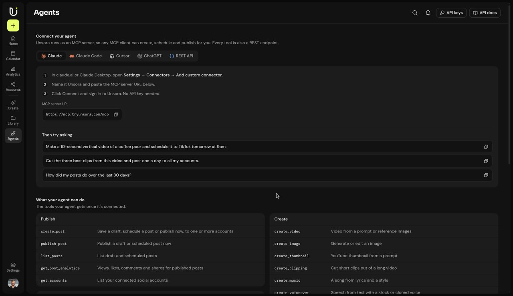
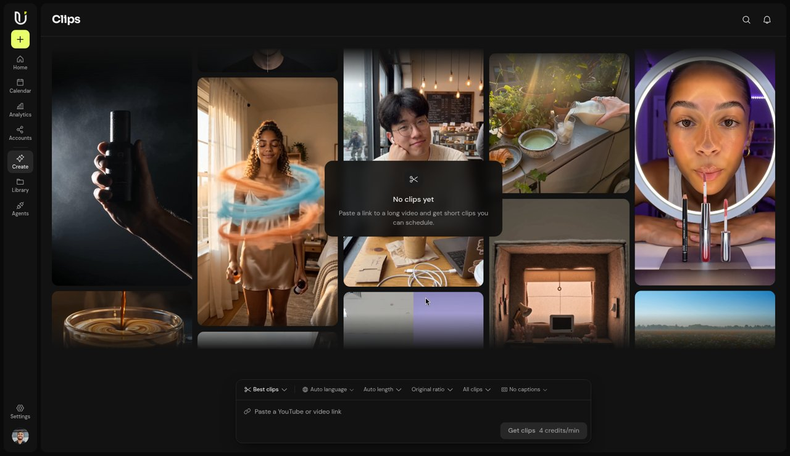

# The Best MCP Servers for Content Creators (2026 List)

A year ago, "AI for creators" meant opening six browser tabs: one for scripts, one for video, one for thumbnails, one for captions, one for scheduling. In 2026 a lot of that work moved into the chat window. Claude, ChatGPT, Cursor and other assistants can now call outside tools through **MCP servers**, so you can ask for a video, a thumbnail or a scheduled post in plain English and the assistant does the clicking.

The catch is that most "best MCP server" lists are written for developers: databases, GitHub, browser automation. This list is for people who make content. Every server below is a **hosted, official remote server** you can add with a URL and a sign-in, with nothing to install.

## What an MCP server does for a creator

MCP (Model Context Protocol) is an open standard that lets an AI assistant use tools hosted somewhere else. You paste a server URL into your assistant's connector settings, sign in once, and the assistant gains new abilities, such as "generate a video", "export this design" or "schedule this post".

For a creator, that means the assistant stops being only a writing partner. It becomes the producer that talks to every tool in your stack, and the results come back into the same conversation.

## How I picked these

- **Official and hosted.** Run by the company behind the product, with a public URL and OAuth sign-in. No community forks that break next month.
- **Useful to creators.** Each one covers a real step: planning, making, editing, voicing or publishing.
- **Works in the big clients.** Claude (custom connectors), ChatGPT (connectors / developer mode), Cursor and Claude Code all accept remote MCP URLs.

## 1. Unsora: video, images, clipping and scheduling in one connector

**Server URL:** `https://mcp.tryunsora.com/mcp`

If you only add one server for content production, make it one that covers the most steps. [Unsora](https://tryunsora.com) is a creative toolkit built for AI agents. One connector gives your assistant video generation with several current models (Seedance 2.5, Kling 3, Veo 3.1 and Gemini Omni Flash), image generation, consistent AI influencers, YouTube thumbnails, clipping long videos into captioned shorts, 4K upscaling, and scheduling to TikTok, Instagram, YouTube, Facebook and LinkedIn.

The setup steps for each client are on the [Unsora connector page](https://tryunsora.com/connector). Once it's connected, prompts like these just work:

- "Make a 10-second vertical video of a coffee pour and schedule it to TikTok tomorrow at 9am."
- "Cut the three best clips from this video and post one a day to all my accounts."
- "How did my posts do over the last 30 days?"

**Best for:** solo creators and small teams who want one credit balance in place of separate video, thumbnail, clipping and scheduling subscriptions. Plans start at $19/month with a 3-day trial.

## 2. Canva: finished designs and exports

**Server URL:** `https://api.canva.com/connect/v1/mcp`

Canva's official MCP server lets an assistant create designs from a text brief, edit existing ones, search your design library, manage assets and brand kits, and export to PDF, PNG, JPG, PPTX or MP4. It's the natural pick when the output needs to match an existing brand template, such as carousels, slide decks and channel art.

**Best for:** creators who already keep their brand kit and templates in Canva.

## 3. Notion: the content calendar and idea bank

**Server URL:** `https://mcp.notion.com/mcp`

Notion's hosted MCP server is the one Notion now recommends (the older open-source server is no longer actively maintained). Your assistant can read and create pages and databases, so "add these ten video ideas to my content calendar with a draft hook for each" turns into real rows in your Notion database.

**Best for:** anyone whose content pipeline already lives in a Notion database.

## 4. ElevenLabs: voiceovers, voices and sound

**Server URL:** `https://api.elevenlabs.io/v1/mcp`

The ElevenLabs remote server gives an assistant text-to-speech, voice design, sound effects and more, billed to your ElevenLabs workspace credits. Pair it with a video server and the assistant can write a script, voice it, and drop it onto a clip in one session. One note from their docs: the version in Claude's connector directory is restricted, so add it as a **custom connector** if you want the full creative toolset.

**Best for:** faceless channels, explainers and podcasts.

## 5. Descript: editing and repurposing recordings

Descript's MCP server (remote, OAuth sign-in) lets an assistant import and transcribe media, edit with Underlord, make social clips from a project and publish to a Descript link. It's a strong choice if you record talking-head videos or podcasts and already edit in Descript. Their docs note that YouTube URLs aren't supported as import sources, so pass a direct file or a Drive link.

**Best for:** podcasters and creators who edit long recordings by transcript.

## 6. Buffer: scheduling to many networks

**Server URL:** `https://mcp.buffer.com/mcp`

Buffer's remote server lets an assistant read your channels and queue, draft and schedule posts, capture ideas and pull analytics. It covers a long list of networks, including Threads, Bluesky, Pinterest and Mastodon. If you already schedule everything in Buffer, this keeps that workflow while letting the assistant fill the queue.

**Best for:** creators who post to many networks beyond the big five.

## Quick comparison

| Server | Main job | Official remote URL |
|---|---|---|
| Unsora | Video, images, thumbnails, clipping, scheduling | `mcp.tryunsora.com/mcp` |
| Canva | Branded designs and exports | `api.canva.com/connect/v1/mcp` |
| Notion | Content calendar and research | `mcp.notion.com/mcp` |
| ElevenLabs | Voiceover and audio | `api.elevenlabs.io/v1/mcp` |
| Descript | Editing recordings, clips | Remote, OAuth (see Descript docs) |
| Buffer | Multi-network scheduling | `mcp.buffer.com/mcp` |

## A starter stack that doesn't overlap

You don't need all six. Too many connectors make the assistant slower to pick the right tool, and you pay for overlapping features. A sensible setup for most solo creators:

1. **One place to plan:** Notion.
2. **One place to produce and publish:** Unsora for video, thumbnails, shorts and scheduling.
3. **One specialist, only if you need it:** Canva for strict brand templates, or ElevenLabs for voice.

Then try a single end-to-end prompt: *"Take the top idea from my Notion content calendar, make a 15-second vertical video for it, write a caption, and schedule it to TikTok and Instagram for Friday 6pm."* If that runs without you opening another tab, the stack is doing its job.

## How to add any of these

The steps are nearly identical in every client:

- **Claude:** Settings → Connectors → Add custom connector, paste the URL, sign in.
- **ChatGPT:** add it as a connector (developer mode for custom URLs), paste the URL, sign in.
- **Cursor / Claude Code:** add the URL to your MCP config (for example `.cursor/mcp.json`) and complete the OAuth prompt.

For a full walkthrough with screenshots and troubleshooting, see my earlier guide: [How to Add a Claude Custom Connector for Video Generation](https://sadekxd.github.io/claude-custom-connector-video-generation/). And if scheduling is your main goal, this one covers it end to end: [How to Schedule TikTok and Instagram Posts From ChatGPT](https://unsoraaivideoguides.blogspot.com/2026/11/how-to-schedule-tiktok-and-instagram.html).

## FAQ

**Are MCP servers free?** The protocol is free, and most servers are free to connect. You pay for the underlying product's plan or credits.

**Is there an official YouTube MCP server?** Not one from Google that I could find. Tools like Unsora and Buffer handle YouTube uploads and scheduling through their own connectors.

**Do I need to code?** No. Every server on this list is hosted. You paste a URL and sign in.

---

*Last updated: November 2026. Know an official creator-focused MCP server that belongs here? Open an issue.*
